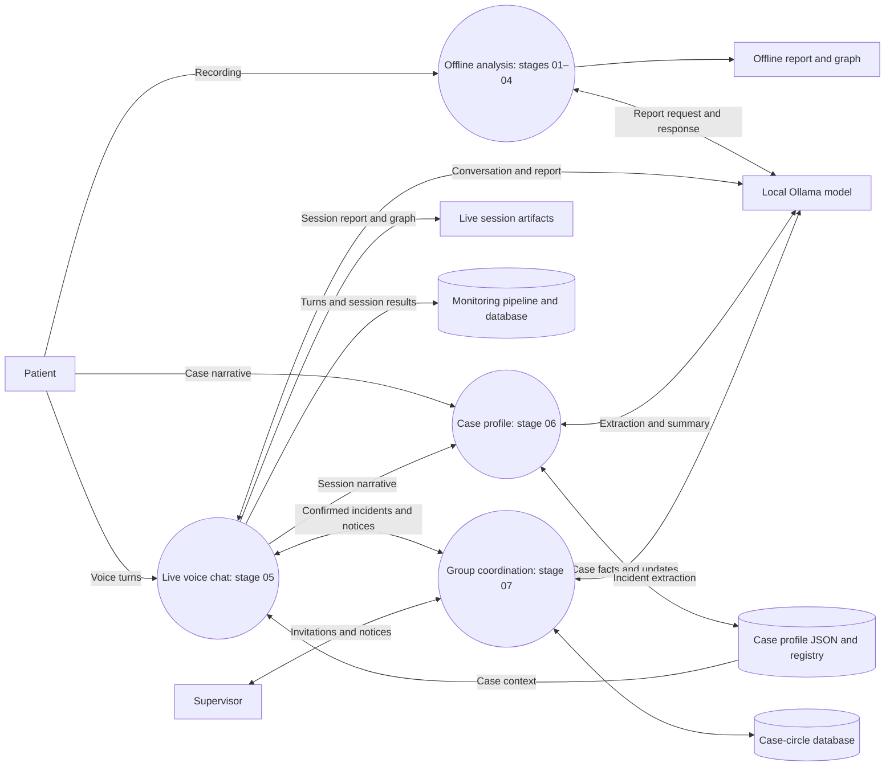
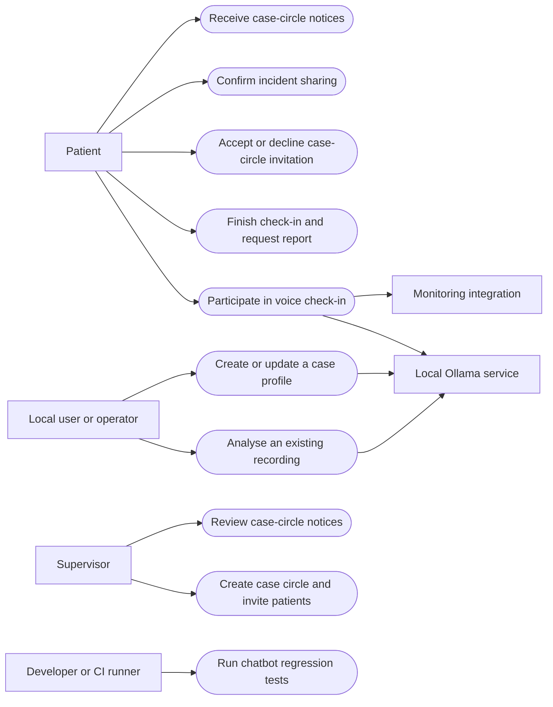

# Chatbot algorithms

This document describes the algorithms implemented by the Python source files in `chatbot/`. There are two related workflows: an offline recording pipeline (stages 01–04) and an interactive voice session (stage 05), supported by case memory (06) and optional group coordination (07). Test files are not separate pipeline algorithms.

## Individual file documents

- [whisper.py](chatbot/01_whisper.md)
- [acoustic_metric.py](chatbot/02_acoustic_metric.md)
- [emotion.py](chatbot/03_emotion.md)
- [chat_llm.py](chatbot/04_chat_llm.md)
- [voice_chat.py](chatbot/05_voice_chat.md)
- [05_voice_chat/patient_registry.py](chatbot/05_patient_registry.md)
- [05_voice_chat/tests/test_voice_chat.py](chatbot/05_test_voice_chat.md)
- [case_profile.py](chatbot/06_case_profile.md)
- [06_case_profile/patient_registry.py](chatbot/06_patient_registry.md)
- [06_case_profile/tests/test_case_profile.py](chatbot/06_test_case_profile.md)
- [group_coordination.py](chatbot/07_group_coordination.md)
- [07_group_coordination/tests/test_group_coordination.py](chatbot/07_test_group_coordination.md)

## Overall flow

```text
Offline: recording → Whisper transcript → acoustic metrics → speech emotion → LLM report + graph
Live:    microphone → Whisper + acoustic metrics + text emotion → conversational reply
                                  ↓                              ↓
                         monitoring pipeline             report + case memory
                                  ↕
                     optional case-circle notices
```

The offline scripts use files in their respective `input` and `output` directories; their outputs must be supplied to the next stage. The live voice script implements its own turn processing and uses **text emotion**, not stage 03's speech-emotion model. Distress scores and labels are decision-support signals, not diagnoses.

## 1. `01_speech_to_text/whisper.py`

**Purpose:** Convert a recording into timestamped text segments.

**Input:** `input/test.wav`. **Outputs:** `output/transcript.txt` and `output/transcript.json`.

### Algorithm

1. Check whether CTranslate2 detects a CUDA device. Select CUDA with float16 when available; otherwise use CPU with int8.
2. Load the `medium` Faster Whisper model. If loading on CUDA raises a runtime error, retry on CPU with int8.
3. Transcribe the recording with beam size 5 and collect the returned segments. Display the detected language and its confidence.
4. For each segment, write its start time, end time and text to the transcript text file. Build a JSON object with `start`, `end` and `text`; round times to two decimal places.
5. Write the JSON segment list. The current script writes the text transcript twice, with the second write replacing the first with the same content.

## 2. `02_acoustic_metrics/acoustic_metric.py`

**Purpose:** Add voice measurements and a simple arousal label to each transcript segment.

**Inputs:** Recording and timestamped transcript JSON. **Output:** `transcript_with_acoustic_metric.json` by default.

### Algorithm

1. Use FFmpeg to decode the recording to mono 16 kHz PCM, then load it with librosa.
2. Read the transcript and validate each segment: timestamps must be finite, ordered and within the recording. Permit a small end-time overshoot caused by the previous stage's rounding, then clamp it to the recording duration.
3. Slice the samples for the segment. If the segment is silent or shorter than the pitch-analysis frame, mark its audio status and return placeholder measurements instead of treating them as reliable pitch measurements.
4. Otherwise estimate pitch with pYIN in the 65–600 Hz range. Keep only finite, voiced frames with probability at least 0.5; pitch is available only when at least two reliable frames remain.
5. Compute pitch mean and standard deviation, RMS energy mean and standard deviation, zero-crossing rate, spectral centroid and the fraction of the segment classified as pauses.
6. If audio or pitch is unavailable, label arousal `unknown`. Otherwise start with score 0: add 1 when pitch standard deviation exceeds 40 Hz, add 1 when energy standard deviation exceeds 0.02, and subtract 1 when pause ratio exceeds 0.3. A score of at least 2 is `high_arousal`; a score of at most -1 is `low_arousal`; otherwise it is `neutral`.
7. Attach the measurements and label to each segment and save the updated JSON list.

## 3. `03_adding_emotions/emotion.py`

**Purpose:** Estimate speech-emotion probabilities for each segment of an offline recording.

**Inputs:** Recording and transcript JSON, normally the stage 02 output. **Output:** `output/transcript_with_emotions.json`.

### Algorithm

1. Decode the recording with FFmpeg into mono 16 kHz audio and read the segment list.
2. Validate every segment's boundaries against the recording, allowing the same small rounding tolerance as stage 02. Slice its corresponding audio.
3. Check the waveform: reject non-finite samples, classify silent audio as `silent` and audio shorter than 0.25 seconds as `too_short`; otherwise mark it `ok`.
4. Load the Wav2Vec2 speech-emotion feature extractor and classifier on CPU only when the first usable segment is encountered.
5. For each usable segment, extract model features, run inference without gradients and apply softmax to obtain a probability for each emotion label. For unusable segments, return an empty probability map.
6. Add the audio status, probability map and highest-probability label (or `null` when no prediction exists) to each segment; save the enriched JSON.

## 4. `04_chat_llm/chat_llm.py`

**Purpose:** Generate a per-segment distress report, clinician summary, patient message and graph from the offline analysis.

**Input:** JSON segments with transcript, acoustic and speech-emotion fields. **Outputs:** `report.json` and `mental_state.png` in the selected output directory.

### Algorithm

1. Read the input segments and prepare a compact representation containing timestamps, text, acoustic features, arousal and emotion quality information.
2. Suppress a confident emotion label when audio status is not `ok`, when no probability is available, when the top probability is below 0.5, or when its lead over the runner-up is below 0.1. Preserve the probabilities and quality status for the model.
3. Send the prepared segments and decision-support instructions to the local Ollama `qwen2.5:7b-instruct` model, requesting JSON.
4. Check the response, remove Markdown fences if present, parse JSON and require `segments`, `clinician_summary` and `patient_message`. Save the raw response for debugging if parsing fails or required keys are missing.
5. Post-process the patient message, including distributing trailing emoji and, when the script's distress conditions are met, adding a suggestion to speak with a doctor.
6. Plot each returned segment's distress score against its start time on a 0–10 vertical scale. Stage the report and graph before replacing the output files; restore the previous report if publishing the graph fails.

## 5. `05_voice_chat/voice_chat.py`

**Purpose:** Run an interactive voice check-in, persist turn data, and produce a session report.

**Inputs:** Required patient ID, microphone audio, optional registered case profile and case-circle membership. **Outputs:** Session checkpoint, report, graph, optional updated case profile and monitoring records.

### Algorithm

1. Initialize the shared database schema and look up the patient's case-profile path. Load available case facts and add them to the conversation's system context.
2. Check invitations and accepted case-circle membership. If group setup fails, continue the personal chat; group notices remain distinct from the patient's own statements.
3. Load the speech-to-text and text-emotion models, create a session ID and an output directory, and display the opening message.
4. Until the patient ends the session:
   1. Retrieve relevant case-circle notices, if any, and record/display them separately from patient text.
   2. Record a microphone turn to a temporary file. Reject empty, silent or too-short audio.
   3. Transcribe in English with Whisper, filter segments using the script's no-speech, log-probability and compression-ratio thresholds, and retry if no usable text remains.
   4. Extract acoustic features and an arousal label; classify emotion from the transcribed text and mark the emotion confidence status. Delete the temporary audio even if processing fails.
   5. Save a checkpoint of the analyzed turn, then attempt to send it to the monitoring integration. Send the conversation and voice cues to Ollama for a reply, and checkpoint the reply or error.
   6. For an accepted group member, look for possible new, firsthand, case-related safety incidents. Share an incident only after explicit confirmation by the patient. Group failures do not stop the personal chat.
5. On completion, attempt independent finalization steps: save the checkpoint, update existing case memory when available, finalize monitoring for ingested turns, generate the local report and graph, and save the report to the monitoring database when possible. A failure in one step does not prevent attempts at the others.

**Session artifacts:** `turns.json`, `report.json`, `mental_state.png`, and, when applicable, `group_notices.json`. The report uses elapsed session time for its graph. Individual turn audio is temporary.

## 6. Patient registry helpers

The files `05_voice_chat/patient_registry.py` and `06_case_profile/patient_registry.py` provide the same registry operations for their respective scripts.

**Purpose:** Associate a patient ID with the file path of that patient's case facts in SQLite.

### Algorithm

1. Resolve the database location from `STILL_DB_PATH` or the script's default database path, open a SQLite connection and ensure the registry schema exists.
2. To register a profile, look up the patient ID, then insert or update the patient-to-profile association, optionally retaining a display name.
3. To look up a profile, query by patient ID and return the stored path, or `None` if no association exists.
4. The case-profile script registers the saved path; the voice script looks it up when a session starts.

## 7. `06_case_profile/case_profile.py`

**Purpose:** Extract structured case information from a patient's narrative and merge it with existing case memory.

**Inputs:** Narrative text file, patient ID and optional existing profile JSON. **Output:** Updated case-facts JSON and a registry entry pointing to it.

### Algorithm

1. Read and validate the input text. Load and normalize an existing profile if supplied or if the destination already exists; reject an ambiguous request that would overwrite a different existing destination.
2. Extract structured clues such as FIR numbers, legal sections and dates using patterns, with optional language-processing support when available. Ask the local LLM to extract narrative information such as case type, hearing events and threats; combine and normalize the results.
3. Merge new facts into the existing profile: update nonempty single-value fields, append new sections and threats without duplicates, and merge matching hearing events while retaining distinct or conflicting events.
4. Treat identical events as duplicates. Otherwise, merge events only when they share an explicit numeric date and do not have conflicting type, outcome or notes. Missing and relative dates alone do not establish a match.
5. Update the timestamp and ask the LLM for a new status summary based on the complete merged profile.
6. Write the result to a temporary JSON file and atomically replace the destination only after successful generation. Register the resulting path against the patient ID.

## 8. `07_group_coordination/group_coordination.py`

**Purpose:** Manage optional case circles and share patient-confirmed safety notices with accepted members and the responsible supervisor.

**Inputs:** Group and patient identifiers, invitation responses, patient statements and explicit confirmation. **Outputs:** SQLite group, membership, incident and alert records; recipient-specific notices.

### Algorithm

1. Create a group for a case and supervisor, validating identifiers and rejecting duplicate group or case IDs. The supervisor can invite patients.
2. When a patient responds, require explicit safety-sharing consent to accept. Within a database transaction, check the patient's case binding, enforce at most one active circle per patient and a maximum of three accepted patients per circle, then record acceptance or decline. A member can later leave.
3. For a patient's current turn, request candidate incidents from the LLM using only the selected case and that turn. Retain only candidates marked firsthand, case-related and new; require a supported kind (`following`, `threat` or `physical_harm`) and an evidence quote appearing exactly in the patient's text.
4. Ask the patient to confirm that each candidate is a new firsthand incident they wish to share. Before recording it, verify that the patient is an accepted, consenting member.
5. Deduplicate by the same turn and kind, or by a fingerprint of the patient report's normalized quote, kind and UTC date. Save a new incident and count distinct patients reporting that kind in the preceding 24 hours.
6. Create an appropriately worded notice and delivery records for the other accepted members and the supervisor. The notice describes reports, not verified findings or proof that the recipient is targeted; it is not an emergency-service dispatch.
7. When listing notices, check recipient access and filter by delivery or acknowledgement state as requested. Patient-facing results omit the source patient's identity and incident details. Mark delivery and acknowledgement only after checking access.

The module also exposes a local command-line interface for group and alert operations. It is a trusted local prototype, rather than a standalone authentication system.

## System data flow diagram



Rectangles represent external participants or files, circles represent processes, and database-shaped nodes represent stored data. Arrows show data flow; test-file diagrams describe test fixtures, temporary storage, and assertions.

## System use case diagram



The rectangles identify participants or external systems; rounded shapes identify use cases. These Mermaid diagrams use a use-case style supported by common Markdown renderers; they are not formal UML use-case notation.
