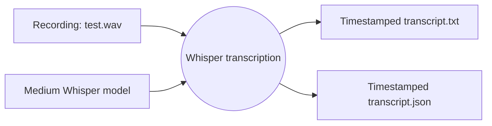
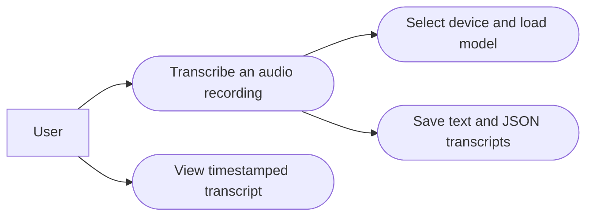

# Algorithm: 1. `01_speech_to_text/whisper.py`

**Purpose:** Convert a recording into timestamped text segments.

**Input:** `input/test.wav`. **Outputs:** `output/transcript.txt` and `output/transcript.json`.

### Algorithm

1. Check whether CTranslate2 detects a CUDA device. Select CUDA with float16 when available; otherwise use CPU with int8.
2. Load the `medium` Faster Whisper model. If loading on CUDA raises a runtime error, retry on CPU with int8.
3. Transcribe the recording with beam size 5 and collect the returned segments. Display the detected language and its confidence.
4. For each segment, write its start time, end time and text to the transcript text file. Build a JSON object with `start`, `end` and `text`; round times to two decimal places.
5. Write the JSON segment list. The current script writes the text transcript twice, with the second write replacing the first with the same content.

## Data flow diagram

## Use case diagram

