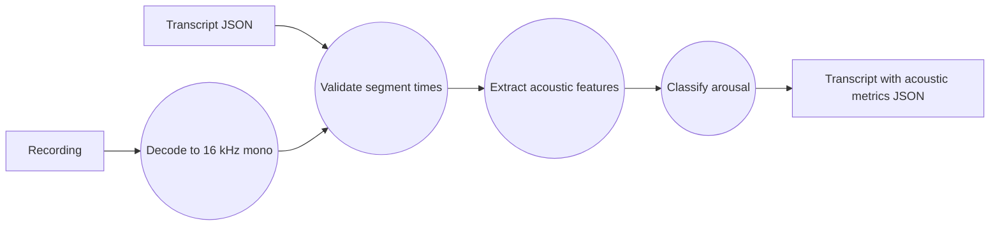
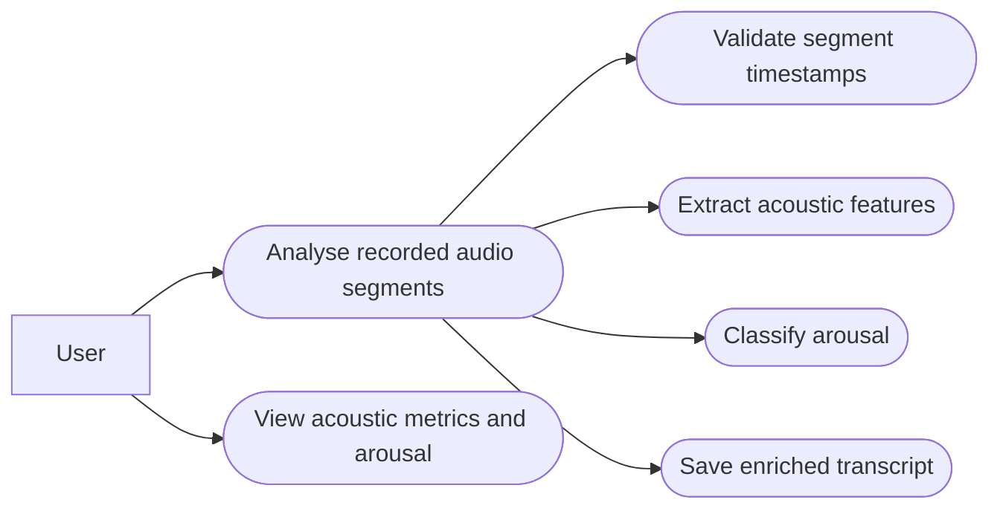

# Algorithm: 2. `02_acoustic_metrics/acoustic_metric.py`

**Purpose:** Add voice measurements and a simple arousal label to each transcript segment.

**Inputs:** Recording and timestamped transcript JSON. **Output:** `transcript_with_acoustic_metric.json` by default.

### Algorithm

1. Use FFmpeg to decode the recording to mono 16 kHz PCM, then load it with librosa.
2. Read the transcript and validate each segment: timestamps must be finite, ordered and within the recording. Permit a small end-time overshoot caused by the previous stage's rounding, then clamp it to the recording duration.
3. Slice the samples for the segment. If the segment is silent or shorter than the pitch-analysis frame, mark its audio status and return placeholder measurements instead of treating them as reliable pitch measurements.
4. Otherwise estimate pitch with pYIN in the 65–600 Hz range. Keep only finite, voiced frames with probability at least 0.5; pitch is available only when at least two reliable frames remain.
5. Compute pitch mean and standard deviation, RMS energy mean and standard deviation, zero-crossing rate, spectral centroid and the fraction of the segment classified as pauses.
6. If audio or pitch is unavailable, label arousal `unknown`. Otherwise start with score 0: add 1 when pitch standard deviation exceeds 40 Hz, add 1 when energy standard deviation exceeds 0.02, and subtract 1 when pause ratio exceeds 0.3. A score of at least 2 is `high_arousal`; a score of at most -1 is `low_arousal`; otherwise it is `neutral`.
7. Attach the measurements and label to each segment and save the updated JSON list.

## Data flow diagram

## Use case diagram

