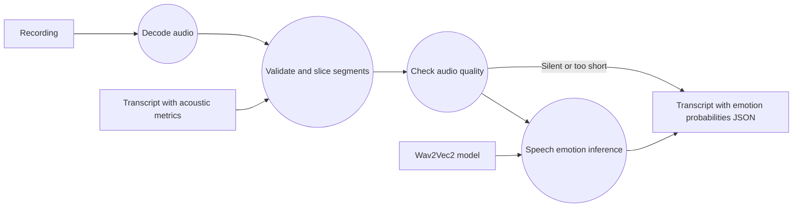
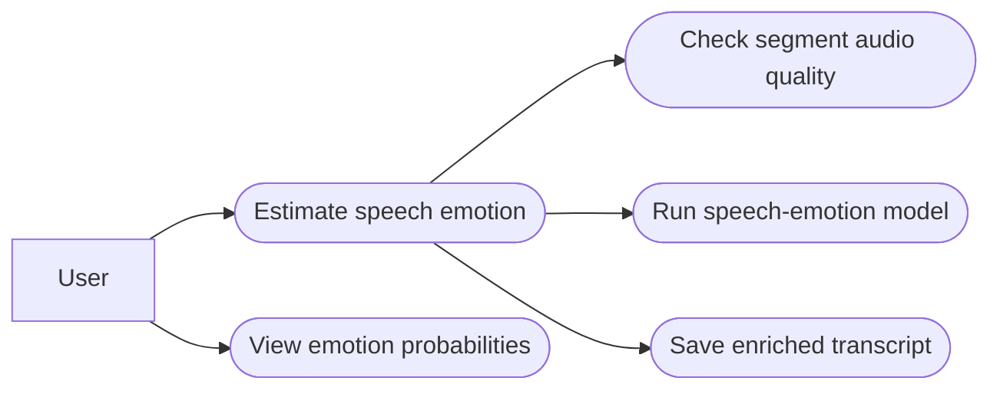

# Algorithm: 3. `03_adding_emotions/emotion.py`

**Purpose:** Estimate speech-emotion probabilities for each segment of an offline recording.

**Inputs:** Recording and transcript JSON, normally the stage 02 output. **Output:** `output/transcript_with_emotions.json`.

### Algorithm

1. Decode the recording with FFmpeg into mono 16 kHz audio and read the segment list.
2. Validate every segment's boundaries against the recording, allowing the same small rounding tolerance as stage 02. Slice its corresponding audio.
3. Check the waveform: reject non-finite samples, classify silent audio as `silent` and audio shorter than 0.25 seconds as `too_short`; otherwise mark it `ok`.
4. Load the Wav2Vec2 speech-emotion feature extractor and classifier on CPU only when the first usable segment is encountered.
5. For each usable segment, extract model features, run inference without gradients and apply softmax to obtain a probability for each emotion label. For unusable segments, return an empty probability map.
6. Add the audio status, probability map and highest-probability label (or `null` when no prediction exists) to each segment; save the enriched JSON.

## Data flow diagram

## Use case diagram

