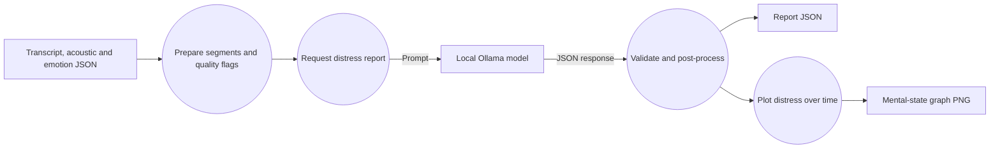
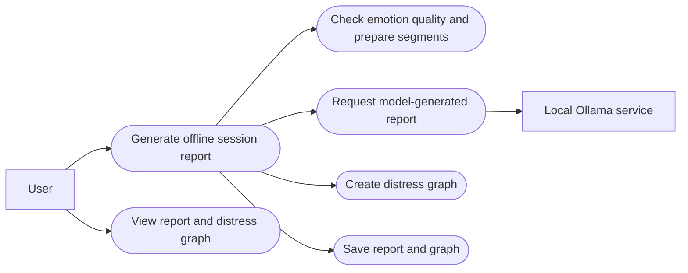

# Algorithm: 4. `04_chat_llm/chat_llm.py`

**Purpose:** Generate a per-segment distress report, clinician summary, patient message and graph from the offline analysis.

**Input:** JSON segments with transcript, acoustic and speech-emotion fields. **Outputs:** `report.json` and `mental_state.png` in the selected output directory.

### Algorithm

1. Read the input segments and prepare a compact representation containing timestamps, text, acoustic features, arousal and emotion quality information.
2. Suppress a confident emotion label when audio status is not `ok`, when no probability is available, when the top probability is below 0.5, or when its lead over the runner-up is below 0.1. Preserve the probabilities and quality status for the model.
3. Send the prepared segments and decision-support instructions to the local Ollama `qwen2.5:7b-instruct` model, requesting JSON.
4. Check the response, remove Markdown fences if present, parse JSON and require `segments`, `clinician_summary` and `patient_message`. Save the raw response for debugging if parsing fails or required keys are missing.
5. Post-process the patient message, including distributing trailing emoji and, when the script's distress conditions are met, adding a suggestion to speak with a doctor.
6. Plot each returned segment's distress score against its start time on a 0–10 vertical scale. Stage the report and graph before replacing the output files; restore the previous report if publishing the graph fails.

## Data flow diagram

## Use case diagram

