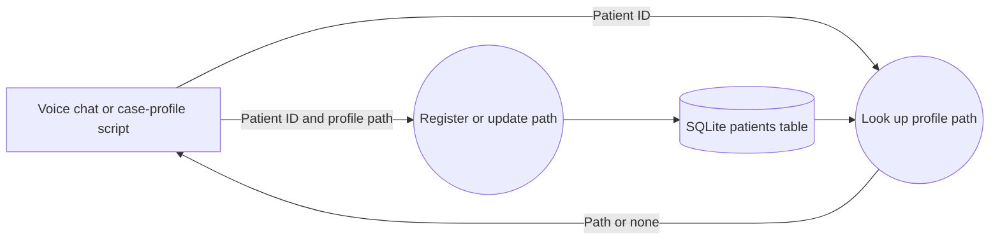
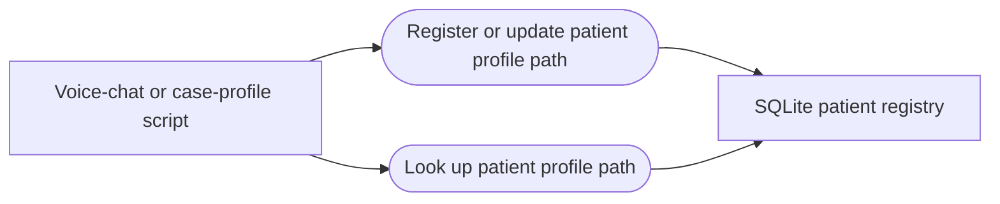

# Algorithm: 6. Patient registry helpers

The files `05_voice_chat/patient_registry.py` and `06_case_profile/patient_registry.py` provide the same registry operations for their respective scripts.

**Purpose:** Associate a patient ID with the file path of that patient's case facts in SQLite.

### Algorithm

1. Resolve the database location from `STILL_DB_PATH` or the script's default database path, open a SQLite connection and ensure the registry schema exists.
2. To register a profile, look up the patient ID, then insert or update the patient-to-profile association, optionally retaining a display name.
3. To look up a profile, query by patient ID and return the stored path, or `None` if no association exists.
4. The case-profile script registers the saved path; the voice script looks it up when a session starts.

## Data flow diagram

## Use case diagram

