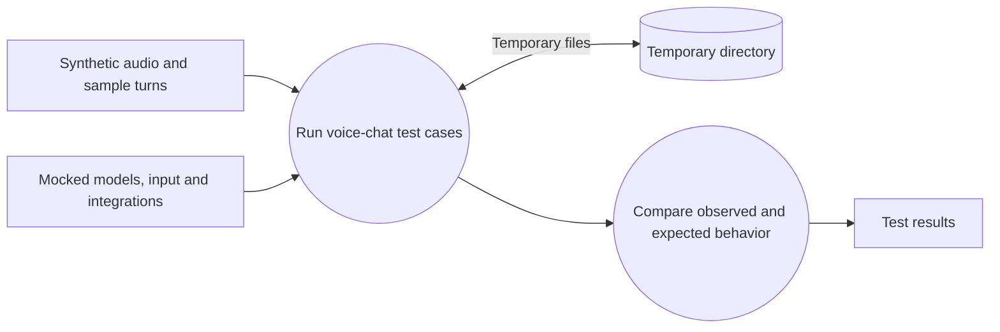
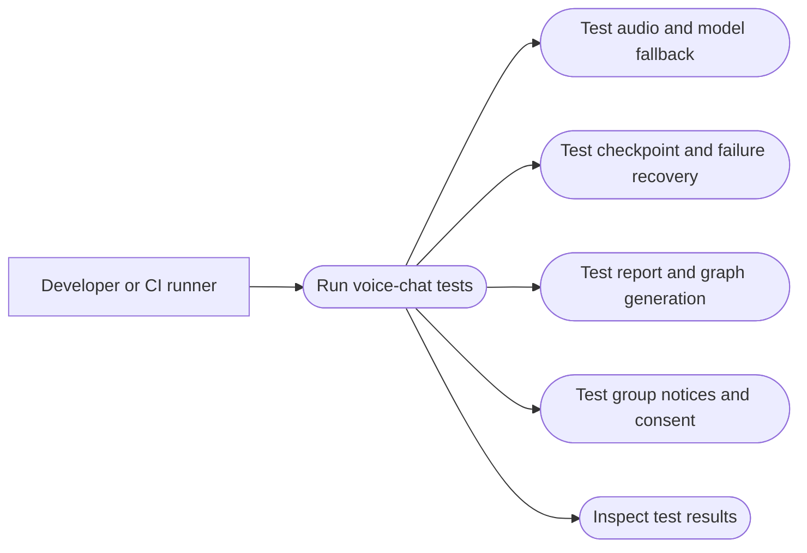

# Algorithm: `05_voice_chat/tests/test_voice_chat.py`

**Purpose:** Verify voice-chat behavior without a microphone, model downloads, Ollama, or a real monitoring database.

**Inputs:** Simulated audio, prepared conversation turns, temporary files, and mocked dependencies. **Output:** Passing or failing `unittest` assertions.

1. Import the real voice-chat module while substituting stubs for monitoring ingestion, case-profile extraction and patient-registry lookup. Restore the original Python module entries afterward.
2. For each test, create a temporary directory, a synthetic 16 kHz tone, example acoustic measurements, a turn and a sample report.
3. Simulate CPU and GPU initialization and verify that emotion-model initialization falls back to CPU when necessary. Check audio and emotion quality, unavailable pitch, and recovery of pitch from a synthetic tone.
4. Simulate a conversation with mocked recording, transcription, model replies and user input. Verify that unusable audio is not transcribed, and that interruptions and transcription or reply failures preserve completed work and clean temporary audio.
5. Check that ending before recording creates no turns, ingestion failures are reported, and session-finalization stages remain independent and use the number of ingested turns.
6. Simulate serialization and graph-publishing failures to check that existing JSON and report files are preserved. Verify report generation includes quality flags and produces a graph.
7. Check case-context handling and verify that group notices remain separate from patient statements and sharing requires fresh patient confirmation.
8. Remove temporary resources after each test.

## Data flow diagram

## Use case diagram

