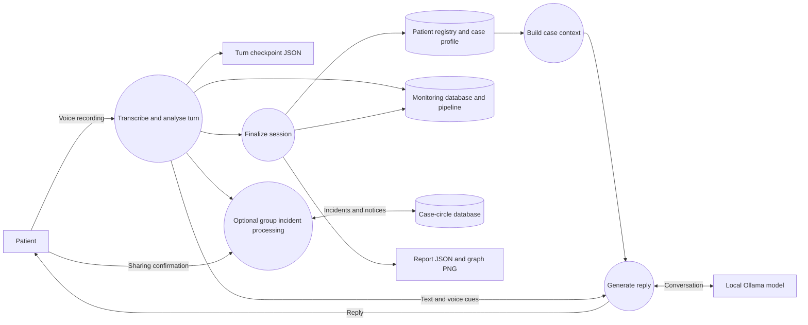
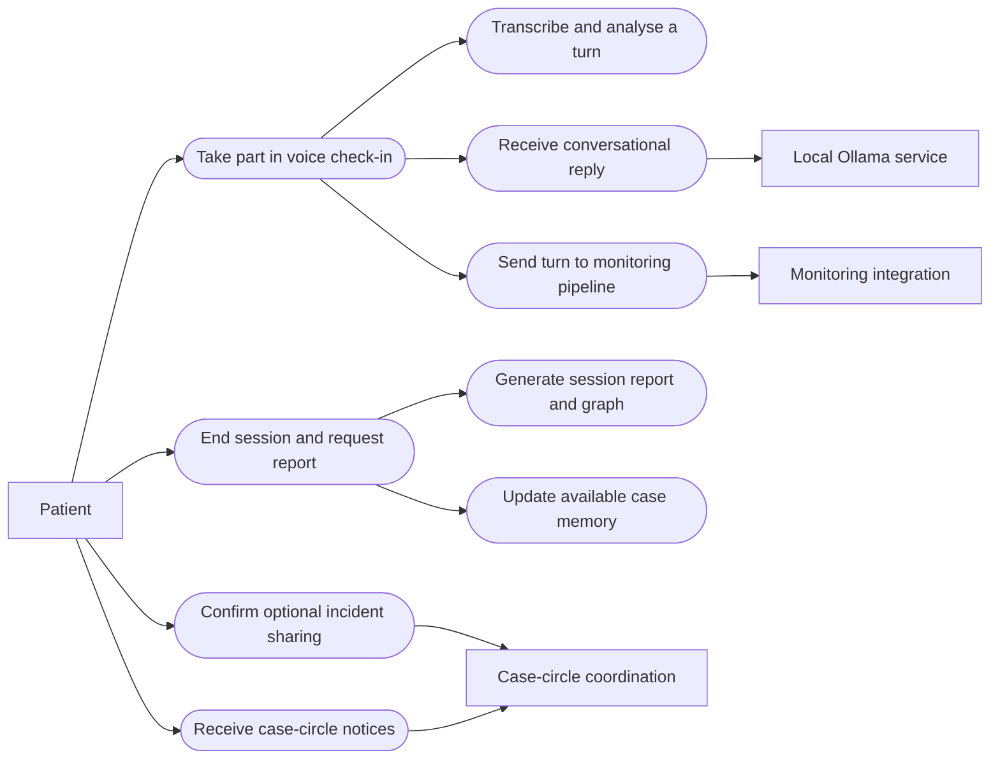

# Algorithm: 5. `05_voice_chat/voice_chat.py`

**Purpose:** Run an interactive voice check-in, persist turn data, and produce a session report.

**Inputs:** Required patient ID, microphone audio, optional registered case profile and case-circle membership. **Outputs:** Session checkpoint, report, graph, optional updated case profile and monitoring records.

### Algorithm

1. Initialize the shared database schema and look up the patient's case-profile path. Load available case facts and add them to the conversation's system context.
2. Check invitations and accepted case-circle membership. If group setup fails, continue the personal chat; group notices remain distinct from the patient's own statements.
3. Load the speech-to-text and text-emotion models, create a session ID and an output directory, and display the opening message.
4. Until the patient ends the session:
   1. Retrieve relevant case-circle notices, if any, and record/display them separately from patient text.
   2. Record a microphone turn to a temporary file. Reject empty, silent or too-short audio.
   3. Transcribe in English with Whisper, filter segments using the script's no-speech, log-probability and compression-ratio thresholds, and retry if no usable text remains.
   4. Extract acoustic features and an arousal label; classify emotion from the transcribed text and mark the emotion confidence status. Delete the temporary audio even if processing fails.
   5. Save a checkpoint of the analyzed turn, then attempt to send it to the monitoring integration. Send the conversation and voice cues to Ollama for a reply, and checkpoint the reply or error.
   6. For an accepted group member, look for possible new, firsthand, case-related safety incidents. Share an incident only after explicit confirmation by the patient. Group failures do not stop the personal chat.
5. On completion, attempt independent finalization steps: save the checkpoint, update existing case memory when available, finalize monitoring for ingested turns, generate the local report and graph, and save the report to the monitoring database when possible. A failure in one step does not prevent attempts at the others.

**Session artifacts:** `turns.json`, `report.json`, `mental_state.png`, and, when applicable, `group_notices.json`. The report uses elapsed session time for its graph. Individual turn audio is temporary.

## Data flow diagram

## Use case diagram

