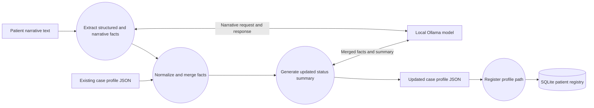
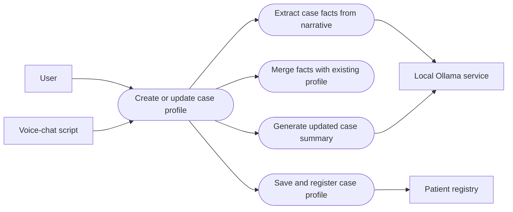

# Algorithm: 7. `06_case_profile/case_profile.py`

**Purpose:** Extract structured case information from a patient's narrative and merge it with existing case memory.

**Inputs:** Narrative text file, patient ID and optional existing profile JSON. **Output:** Updated case-facts JSON and a registry entry pointing to it.

### Algorithm

1. Read and validate the input text. Load and normalize an existing profile if supplied or if the destination already exists; reject an ambiguous request that would overwrite a different existing destination.
2. Extract structured clues such as FIR numbers, legal sections and dates using patterns, with optional language-processing support when available. Ask the local LLM to extract narrative information such as case type, hearing events and threats; combine and normalize the results.
3. Merge new facts into the existing profile: update nonempty single-value fields, append new sections and threats without duplicates, and merge matching hearing events while retaining distinct or conflicting events.
4. Treat identical events as duplicates. Otherwise, merge events only when they share an explicit numeric date and do not have conflicting type, outcome or notes. Missing and relative dates alone do not establish a match.
5. Update the timestamp and ask the LLM for a new status summary based on the complete merged profile.
6. Write the result to a temporary JSON file and atomically replace the destination only after successful generation. Register the resulting path against the patient ID.

## Data flow diagram

## Use case diagram

