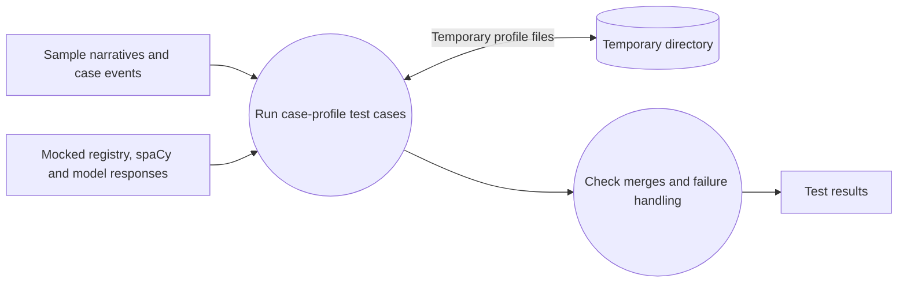
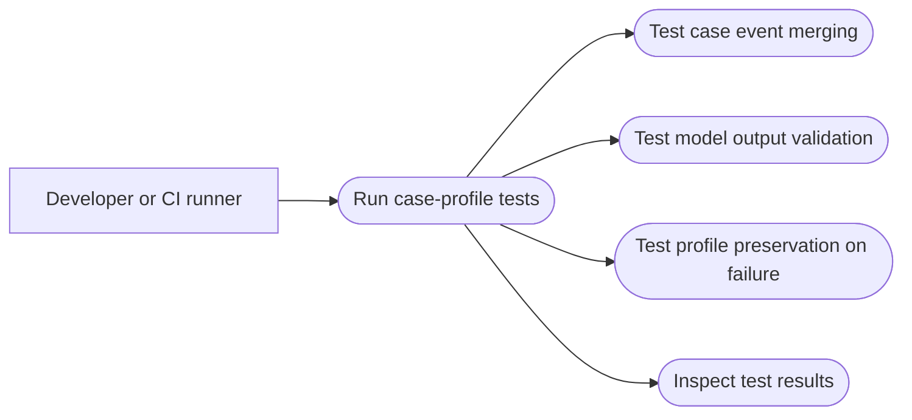

# Algorithm: `06_case_profile/tests/test_case_profile.py`

**Purpose:** Test case-memory extraction, merging and safe file updates without real model downloads or registry writes.

**Inputs:** Sample case events, mocked model responses and temporary profile files. **Output:** Passing or failing `unittest` assertions.

1. Import the case-profile module with a mocked patient registry and an unavailable optional spaCy model; restore the original modules afterward.
2. Create a temporary narrative input and profile destination for each test. Mock Ollama responses where required.
3. Exercise event matching: unrelated undated events and different events with the same relative phrase remain separate; identical events are not duplicated; complementary details for an explicit date merge, but conflicts stay separate. Check that inputs are not mutated.
4. Test normalization of null lists and empty events, and reject malformed facts and invalid model JSON.
5. Check that an existing destination is loaded when no explicit existing path is supplied, and that invalid existing data stops model calls and prevents overwriting.
6. Simulate invalid new facts, summary generation failure and file-replacement failure. Verify that the existing profile is preserved and temporary files are cleaned up.
7. Verify that an explicitly selected source cannot overwrite a different existing destination. Clean up temporary files after the tests.

## Data flow diagram

## Use case diagram

