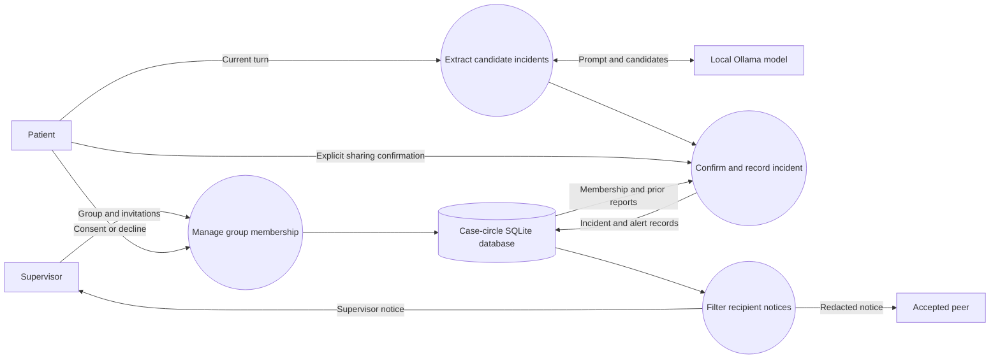
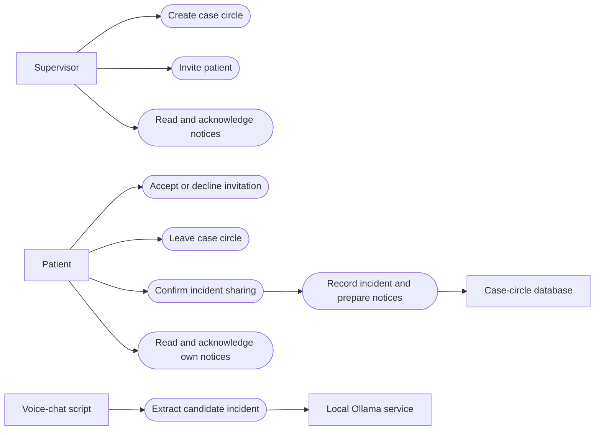

# Algorithm: 8. `07_group_coordination/group_coordination.py`

**Purpose:** Manage optional case circles and share patient-confirmed safety notices with accepted members and the responsible supervisor.

**Inputs:** Group and patient identifiers, invitation responses, patient statements and explicit confirmation. **Outputs:** SQLite group, membership, incident and alert records; recipient-specific notices.

### Algorithm

1. Create a group for a case and supervisor, validating identifiers and rejecting duplicate group or case IDs. The supervisor can invite patients.
2. When a patient responds, require explicit safety-sharing consent to accept. Within a database transaction, check the patient's case binding, enforce at most one active circle per patient and a maximum of three accepted patients per circle, then record acceptance or decline. A member can later leave.
3. For a patient's current turn, request candidate incidents from the LLM using only the selected case and that turn. Retain only candidates marked firsthand, case-related and new; require a supported kind (`following`, `threat` or `physical_harm`) and an evidence quote appearing exactly in the patient's text.
4. Ask the patient to confirm that each candidate is a new firsthand incident they wish to share. Before recording it, verify that the patient is an accepted, consenting member.
5. Deduplicate by the same turn and kind, or by a fingerprint of the patient report's normalized quote, kind and UTC date. Save a new incident and count distinct patients reporting that kind in the preceding 24 hours.
6. Create an appropriately worded notice and delivery records for the other accepted members and the supervisor. The notice describes reports, not verified findings or proof that the recipient is targeted; it is not an emergency-service dispatch.
7. When listing notices, check recipient access and filter by delivery or acknowledgement state as requested. Patient-facing results omit the source patient's identity and incident details. Mark delivery and acknowledgement only after checking access.

The module also exposes a local command-line interface for group and alert operations. It is a trusted local prototype, rather than a standalone authentication system.

## Data flow diagram

## Use case diagram

