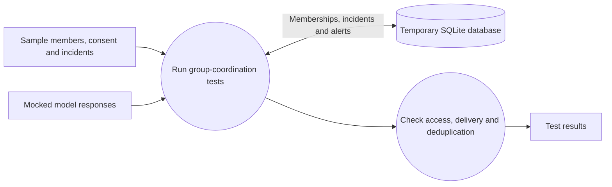
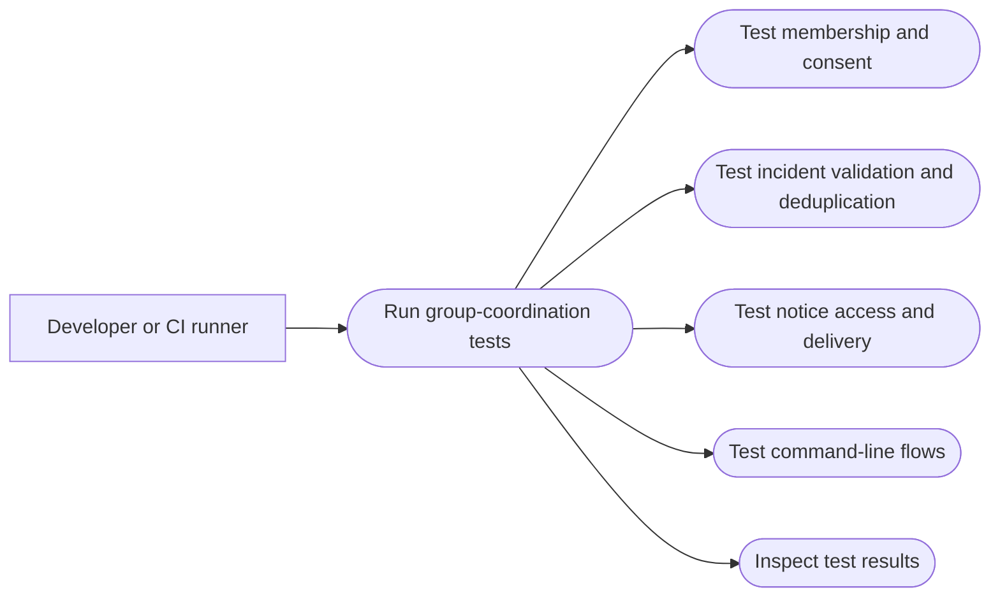

# Algorithm: `07_group_coordination/tests/test_group_coordination.py`

**Purpose:** Verify case-circle membership, incident handling and notice delivery using an isolated SQLite database.

**Inputs:** Temporary database, sample group members and incidents, and mocked language-model responses. **Output:** Passing or failing `unittest` assertions.

1. Dynamically load the group-coordination module. For each test, create a temporary SQLite database, point `STILL_DB_PATH` to it, create a group and prepare a sample incident.
2. Test invitation ownership, explicit sharing consent, declines, the three-member limit and the restriction that a patient has one active case circle and a single case binding in the prototype.
3. Create confirmed incident reports and verify that notices go only to accepted peers and the group's supervisor, remain isolated by case, and are not retroactively delivered to later joiners.
4. Repeat reports and retries to verify deduplication. Check that pattern counts represent distinct people rather than the number of messages.
5. Exercise delivery, acknowledgement and leaving a group; verify that those actions do not create incidents and unauthorized recipients cannot access notices.
6. Verify that incident extraction requires new firsthand, case-related evidence and that even manually submitted reports require patient confirmation.
7. Exercise CLI invitation and acceptance flows and check that patient inboxes show the latest notices appropriately while retaining history and keeping categories separate. Check supervisor access to individual reports and CLI JSON output.
8. Clean up the environment override and temporary database.

## Data flow diagram

## Use case diagram

